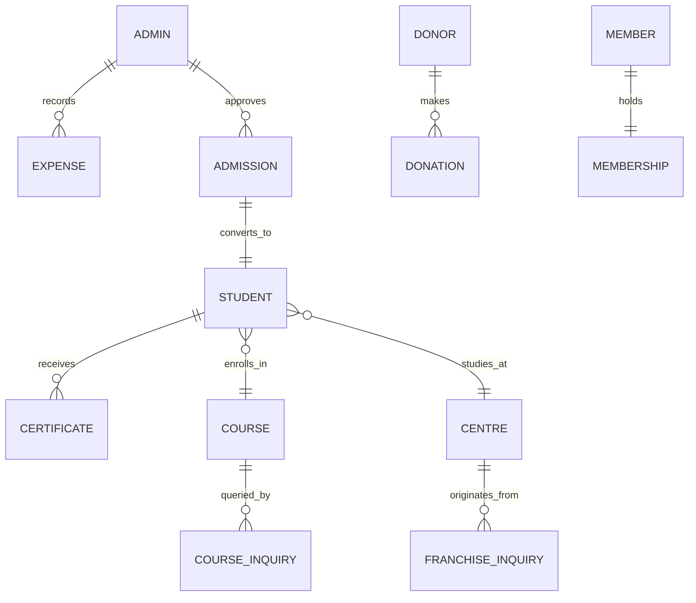

# H.I.T India Skill Development Foundation - MongoDB Atlas Database Schemas (`schema.md`)

This document defines the complete MongoDB database design and production-ready **Mongoose** schema models for the **H.I.T India Skill Development Foundation** backend. Every collection, attribute, constraint, index, and relationship directly maps to the frontend requirements.

---

## 1. Architecture & Entity Relationship Diagram



---

## 2. MongoDB Atlas Collections Summary

| # | Collection Name | Mongoose Model | Primary Purpose |
| :- | :--- | :--- | :--- |
| 1 | `admins` | `Admin` | Central trustees, director desk, and registrars with hashed passwords |
| 2 | `students` | `Student` | Enrolled students, academic dossiers, attendance, grades, and portal logins |
| 3 | `admissions` | `Admission` | Direct admission applications, ₹100 registration fee records, and approval queue |
| 4 | `courses` | `Course` | Vocational & diploma curriculum (ADCA, CCC, BCC, Tally, DTP, CHW, etc.) |
| 5 | `university_programs` | `UniversityProgram` | Degree and distance courses (BA, B.Com, BCA, MCA, MBA, PGDCA) |
| 6 | `centres` | `Centre` | Affiliated training centres and regional campuses |
| 7 | `franchise_inquiries`| `FranchiseInquiry`| Requests from educators and coaching centres seeking H.I.T affiliation |
| 8 | `course_inquiries` | `CourseInquiry` | Free university course counseling inquiries |
| 9 | `donations` | `Donation` | Philanthropic donations and 50% statutory 80G tax exemption receipts |
| 10| `memberships` | `Membership` | Foundation members (Patron, Life, Annual, Volunteer) with digital PVC ID |
| 11| `expenses` | `Expense` | Public financial transparency ledger (lab hardware, internet, honorarium) |
| 12| `gallery_items` | `GalleryItem` | Institutional events, convocation felicitations, and lab photos |
| 13| `certificates` | `Certificate` | Cryptographic ledger entries for student diploma and roll verification |

---

## 3. Production-Ready Mongoose Models

You can directly place these models inside your backend project's `models/` directory (e.g. `models/Student.js`, `models/Admission.js`, etc.).

---

### 3.1 Admin Schema (`models/Admin.js`)

```javascript
const mongoose = require('mongoose');
const bcrypt = require('bcryptjs');

const adminSchema = new mongoose.Schema(
  {
    name: {
      type: String,
      required: [true, 'Admin name is required'],
      trim: true,
      default: 'Super Admin / Director Desk',
    },
    email: {
      type: String,
      required: [true, 'Email is required'],
      unique: true,
      lowercase: true,
      trim: true,
      match: [/^\S+@\S+\.\S+$/, 'Please enter a valid email'],
    },
    password: {
      type: String,
      required: [true, 'Password is required'],
      minlength: [6, 'Password must be at least 6 characters'],
      select: false, // Hidden by default in queries
    },
    role: {
      type: String,
      enum: ['Super Admin & Central Trustee', 'Centre Administrator', 'Academic Coordinator', 'Treasurer / Registrar'],
      default: 'Super Admin & Central Trustee',
    },
    mobile: {
      type: String,
      trim: true,
    },
    isActive: {
      type: Boolean,
      default: true,
    },
    lastLogin: {
      type: Date,
    },
  },
  { timestamps: true }
);

// Hash password before saving
adminSchema.pre('save', async function (next) {
  if (!this.isModified('password')) return next();
  const salt = await bcrypt.genSalt(10);
  this.password = await bcrypt.hash(this.password, salt);
  next();
});

// Compare password method
adminSchema.methods.comparePassword = async function (enteredPassword) {
  return await bcrypt.compare(enteredPassword, this.password);
};

module.exports = mongoose.model('Admin', adminSchema);
```

---

### 3.2 Student Schema (`models/Student.js`)

```javascript
const mongoose = require('mongoose');
const bcrypt = require('bcryptjs');

const subjectSchema = new mongoose.Schema({
  name: { type: String, required: true },
  marks: { type: String, required: true, default: '85/100' },
  grade: { type: String, required: true, default: 'A' },
});

const studentSchema = new mongoose.Schema(
  {
    rollNo: {
      type: String,
      required: true,
      unique: true,
      trim: true,
      index: true,
      uppercase: true, // e.g. HIT-STU-2026-00001
    },
    admissionNo: {
      type: String,
      required: true,
      unique: true,
      trim: true,
      uppercase: true, // e.g. HIT-ADM-2026-00001
    },
    fullName: {
      type: String,
      required: [true, 'Full name is required'],
      trim: true,
    },
    fatherName: {
      type: String,
      required: [true, 'Father name is required'],
      trim: true,
    },
    motherName: {
      type: String,
      trim: true,
      default: 'Shanti Devi',
    },
    dob: {
      type: String, // Stored as YYYY-MM-DD or formatted date
      required: true,
    },
    gender: {
      type: String,
      enum: ['Male', 'Female', 'Other'],
      default: 'Male',
    },
    category: {
      type: String,
      enum: ['General', 'OBC', 'SC', 'ST', 'EWS'],
      default: 'General',
    },
    mobile: {
      type: String,
      required: true,
      trim: true,
    },
    email: {
      type: String,
      required: true,
      lowercase: true,
      trim: true,
    },
    password: {
      type: String,
      default: '$2a$10$WkL...password123Hash', // default password123
      select: false,
    },
    address: {
      line: { type: String, default: 'Kasba Khas, Ward 4' },
      district: { type: String, default: 'Mau' },
      state: { type: String, default: 'Uttar Pradesh' },
      pincode: { type: String, default: '275105' },
    },
    bloodGroup: {
      type: String,
      enum: ['A+', 'A-', 'B+', 'B-', 'O+', 'O-', 'AB+', 'AB-', 'Unknown'],
      default: 'B+',
    },
    emergencyContact: {
      type: String,
      default: '+91 94520-11223',
    },
    photoUrl: {
      type: String,
      default: 'https://lh3.googleusercontent.com/aida-public/AB6AXuC7w1t1k4oE5UqY7CjyUR9wr4ds1UGeSFZ3ypw5-HptD0EkF58K5E_vmI_bA_f-uvoCN_b5QE-r2mxd-Qkmddhft6wn7PXH7whtkiBb1dTJDjJVOyAKIo7zA0yQzmr4PUxGNfinra069nOa3zmuRri1yPodaLmd6-OIFQGJKZaRvAf485ZePcjl6rZon7kqfgLE1uKxMG6GpvCoyemhXKNm4PSZixEqRPRApUwBqT4PhqUJoBZ3PrTiSQ',
    },
    aadhaarUrl: {
      type: String,
    },
    courseId: {
      type: String,
      required: true, // e.g. "adca"
    },
    courseCode: {
      type: String,
      required: true,
      default: 'ADCA',
    },
    courseName: {
      type: String,
      required: true,
      default: 'Advance Diploma in Computer Applications (ADCA)',
    },
    courseDuration: {
      type: String,
      default: '12 Months',
    },
    centreCode: {
      type: String,
      required: true,
      default: 'HIT-CEN-0001',
    },
    centreName: {
      type: String,
      required: true,
      default: 'Ghosi Main Training Centre',
    },
    centreAddress: {
      type: String,
      default: 'Kasba Khas, Ghosi, Mau, UP - 275105',
    },
    batchTime: {
      type: String,
      default: 'Morning Batch (08:00 AM – 10:00 AM)',
    },
    enrollmentDate: {
      type: String,
      default: () => new Date().toLocaleDateString('en-GB', { day: '2-digit', month: 'short', year: 'numeric' }),
    },
    validUpto: {
      type: String,
      default: 'January 2027',
    },
    status: {
      type: String,
      enum: ['Active Enrolled Student', 'Completed', 'Dropped', 'Suspended'],
      default: 'Active Enrolled Student',
    },
    attendance: {
      type: String,
      default: '94.5%',
    },
    overallGrade: {
      type: String,
      enum: ['A+', 'A', 'B+', 'B', 'C', 'Pending'],
      default: 'A+',
    },
    modulesCompleted: {
      type: String,
      default: '1 / 8 Modules',
    },
    nextExam: {
      type: String,
      default: 'Unit 1 Practical Test (Scheduled Next Month)',
    },
    feeStatus: {
      type: String,
      default: 'Paid (₹12,000)',
    },
    downloadedIdCount: {
      type: Number,
      default: 0,
    },
    subjects: [subjectSchema],
  },
  { timestamps: true }
);

// Search text index for student searches
studentSchema.index({ fullName: 'text', rollNo: 'text', mobile: 'text', email: 'text' });

module.exports = mongoose.model('Student', studentSchema);
```

---

### 3.3 Admission Application Schema (`models/Admission.js`)

```javascript
const mongoose = require('mongoose');

const admissionSchema = new mongoose.Schema(
  {
    regId: {
      type: String,
      required: true,
      unique: true,
      uppercase: true, // e.g. HIT-ADM-2026-00048
    },
    rollId: {
      type: String,
      required: true,
      unique: true,
      uppercase: true, // e.g. HIT-STU-2026-00048
    },
    fullName: {
      type: String,
      required: [true, 'Student name is required'],
      trim: true,
    },
    fatherName: {
      type: String,
      required: true,
      trim: true,
    },
    motherName: {
      type: String,
      trim: true,
      default: 'Shanti Devi',
    },
    dob: {
      type: String,
      required: true,
    },
    gender: {
      type: String,
      enum: ['Male', 'Female', 'Other'],
      required: true,
    },
    category: {
      type: String,
      default: 'General',
    },
    mobile: {
      type: String,
      required: true,
      trim: true,
    },
    email: {
      type: String,
      required: true,
      lowercase: true,
      trim: true,
    },
    address: {
      line: String,
      district: String,
      state: String,
      pincode: String,
    },
    courseId: {
      type: String,
      required: true,
    },
    courseName: {
      type: String,
      required: true,
    },
    centreId: {
      type: String,
      required: true,
    },
    centreName: {
      type: String,
      required: true,
    },
    batchTime: {
      type: String,
      default: '08:00 AM - 10:00 AM (Morning)',
    },
    qualification: {
      type: String,
      default: '12th Pass',
    },
    aadhaarNo: {
      type: String,
      required: true,
    },
    registrationFee: {
      type: Number,
      default: 100, // Flat ₹100 registration fee
    },
    feeStatus: {
      type: String,
      default: '₹100 Registration Settled (Online)',
    },
    paymentMode: {
      type: String,
      enum: ['upi', 'card', 'netbanking', 'cash'],
      default: 'upi',
    },
    paymentRef: {
      type: String,
      default: () => `UPI-${Math.floor(100000000000 + Math.random() * 900000000000)}`,
    },
    status: {
      type: String,
      enum: ['Pending', 'Approved', 'Revision Needed', 'Rejected'],
      default: 'Approved',
    },
    certificateIssued: {
      type: Boolean,
      default: false,
    },
    approvedBy: {
      type: String,
      default: 'Super Admin / Director Desk',
    },
  },
  { timestamps: true }
);

module.exports = mongoose.model('Admission', admissionSchema);
```

---

### 3.4 Vocational Course Schema (`models/Course.js`)

```javascript
const mongoose = require('mongoose');

const courseSchema = new mongoose.Schema(
  {
    id: {
      type: String,
      required: true,
      unique: true,
      lowercase: true, // e.g. "adca", "ccc", "bcc", "dtp"
    },
    code: {
      type: String,
      required: true,
      trim: true,
      uppercase: true, // e.g. "ADCA", "CCC", "BCC"
    },
    name: {
      type: String,
      required: [true, 'Course name is required'],
      trim: true,
    },
    duration: {
      type: String,
      required: true, // e.g. "12 Month", "3 Month", "6 Month"
    },
    eligibility: {
      type: String,
      default: '10th / 12th Pass',
    },
    formula: {
      type: String,
      default: '',
    },
    modules: [
      {
        type: String,
      },
    ],
    fee: {
      type: String,
      required: true, // e.g. "₹12,000" or "₹100 Reg. + ₹600/mo"
    },
    feeAmount: {
      type: Number,
      default: 6000,
    },
    icon: {
      type: String,
      default: 'terminal', // Material Symbol name
    },
    popular: {
      type: Boolean,
      default: false,
    },
    isActive: {
      type: Boolean,
      default: true,
    },
  },
  { timestamps: true }
);

module.exports = mongoose.model('Course', courseSchema);
```

---

### 3.5 University Degree & Distance Programs Schema (`models/UniversityProgram.js`)

```javascript
const mongoose = require('mongoose');

const universityProgramSchema = new mongoose.Schema(
  {
    id: {
      type: String,
      required: true,
      unique: true,
      lowercase: true, // e.g. "univ-bca", "univ-ba", "univ-mca"
    },
    code: {
      type: String,
      required: true, // e.g. "BCA", "BA", "B.Com", "MCA", "MBA"
    },
    name: {
      type: String,
      required: true,
    },
    duration: {
      type: String,
      required: true, // e.g. "3 Years (6 Semesters)"
    },
    eligibility: {
      type: String,
      required: true,
    },
    mode: {
      type: String,
      default: 'Online & Distance Mode',
    },
    type: {
      type: String,
      enum: ['Undergraduate Degree', 'Postgraduate Degree', 'Postgraduate Diploma', 'Degree & Diploma Programs'],
      default: 'Undergraduate Degree',
    },
    fee: {
      type: String,
      default: 'Flexible University Slabs',
    },
    streams: {
      type: String,
      default: '',
    },
    icon: {
      type: String,
      default: 'laptop_chromebook',
    },
    popular: {
      type: Boolean,
      default: true,
    },
    isActive: {
      type: Boolean,
      default: true,
    },
  },
  { timestamps: true }
);

module.exports = mongoose.model('UniversityProgram', universityProgramSchema);
```

---

### 3.6 Affiliated Training Centre Schema (`models/Centre.js`)

```javascript
const mongoose = require('mongoose');

const centreSchema = new mongoose.Schema(
  {
    id: {
      type: String,
      required: true,
      unique: true, // e.g. "HIT-CEN-0001"
    },
    name: {
      type: String,
      required: true, // e.g. "Ghosi Main Training Centre"
    },
    district: {
      type: String,
      required: true, // e.g. "Mau", "Azamgarh", "Varanasi"
    },
    address: {
      type: String,
      required: true,
    },
    status: {
      type: String,
      enum: ['Active HQ', 'Active', 'Upcoming', 'Suspended'],
      default: 'Active',
    },
    directorName: {
      type: String,
      default: 'Centre Incharge',
    },
    contactPhone: {
      type: String,
      default: '+91 94520-78192',
    },
    contactEmail: {
      type: String,
      default: 'centre@hitindia.org',
    },
    totalPCs: {
      type: Number,
      default: 20,
    },
  },
  { timestamps: true }
);

module.exports = mongoose.model('Centre', centreSchema);
```

---

### 3.7 Franchise / Affiliation Application Schema (`models/FranchiseInquiry.js`)

```javascript
const mongoose = require('mongoose');

const franchiseInquirySchema = new mongoose.Schema(
  {
    applicationRef: {
      type: String,
      unique: true,
      default: () => `HIT-FRAN-2026-${Math.floor(1000 + Math.random() * 9000)}`,
    },
    name: {
      type: String,
      required: [true, 'Director / Centre Owner Name is required'],
      trim: true,
    },
    phone: {
      type: String,
      required: [true, 'Mobile number is required'],
      trim: true,
    },
    email: {
      type: String,
      lowercase: true,
      trim: true,
    },
    city: {
      type: String,
      required: [true, 'Proposed City & District is required'],
      trim: true,
    },
    centerType: {
      type: String,
      enum: ['New Computer Center', 'Already Running Center', 'School / College Lab', 'Coaching Institute'],
      default: 'New Computer Center',
    },
    pcCount: {
      type: String,
      enum: ['5 to 10 Computers', '10 to 20 Computers', '20+ Computers', 'Planning to Purchase'],
      default: '10 to 20 Computers',
    },
    spaceAvailable: {
      type: String,
      enum: ['300 to 500 Sq. Ft.', '500 to 1000 Sq. Ft.', '1000+ Sq. Ft.', 'Looking for Space'],
      default: '300 to 500 Sq. Ft.',
    },
    status: {
      type: String,
      enum: ['New', 'Contacted', 'Documentation In Review', 'Approved', 'Rejected'],
      default: 'New',
    },
    adminNotes: {
      type: String,
      default: '',
    },
  },
  { timestamps: true }
);

module.exports = mongoose.model('FranchiseInquiry', franchiseInquirySchema);
```

---

### 3.8 University Course Inquiry Schema (`models/CourseInquiry.js`)

```javascript
const mongoose = require('mongoose');

const courseInquirySchema = new mongoose.Schema(
  {
    programId: {
      type: String,
      required: true,
    },
    programName: {
      type: String,
      required: true,
    },
    name: {
      type: String,
      required: true,
      trim: true,
    },
    phone: {
      type: String,
      required: true,
      trim: true,
    },
    qualification: {
      type: String,
      default: '12th Pass',
    },
    status: {
      type: String,
      enum: ['New', 'Counselor Assigned', 'Follow-up Scheduled', 'Enrolled', 'Closed'],
      default: 'New',
    },
  },
  { timestamps: true }
);

module.exports = mongoose.model('CourseInquiry', courseInquirySchema);
```

---

### 3.9 Donation & 80G Receipt Schema (`models/Donation.js`)

```javascript
const mongoose = require('mongoose');

const donationSchema = new mongoose.Schema(
  {
    txnId: {
      type: String,
      required: true,
      unique: true, // e.g. "pay_P982Kjx9128Kz_HITDON"
    },
    receiptNo: {
      type: String,
      required: true,
      unique: true, // e.g. "HIT/80G/2026/0892"
      index: true,
    },
    date: {
      type: String,
      default: () =>
        new Date().toLocaleDateString('en-IN', {
          day: '2-digit',
          month: 'short',
          year: 'numeric',
          hour: '2-digit',
          minute: '2-digit',
        }),
    },
    donorName: {
      type: String,
      required: [true, 'Donor name is required'],
      trim: true,
    },
    donorPan: {
      type: String,
      required: [true, 'PAN number is required for 80G statutory exemption'],
      uppercase: true,
      trim: true,
      match: [/^[A-Z]{5}[0-9]{4}[A-Z]{1}$/, 'Please enter a valid 10-digit PAN format'],
    },
    donorEmail: {
      type: String,
      required: true,
      lowercase: true,
      trim: true,
    },
    donorPhone: {
      type: String,
      required: true,
      trim: true,
    },
    donorAddress: {
      type: String,
      required: true,
    },
    amount: {
      type: Number,
      required: [true, 'Donation amount is required'],
      min: [100, 'Minimum donation amount is ₹100'],
    },
    amountInWords: {
      type: String,
      default: '',
    },
    purpose: {
      type: String,
      default: 'Vocational & Digital Skill Sponsorship for Underprivileged Girls',
    },
    taxExemptionEligible: {
      type: Number,
      required: true, // 50% of donation amount under Section 80G
    },
    orderRef: {
      type: String,
      default: () => `ORD_2026_${Math.floor(10000 + Math.random() * 90000)}`,
    },
    mode: {
      type: String,
      default: 'UPI Auto-Settled (Razorpay Webhook)',
    },
    bankRef: {
      type: String,
      default: () => `UPI-${Math.floor(100000000000 + Math.random() * 900000000000)}`,
    },
    paymentGatewayStatus: {
      type: String,
      enum: ['Success', 'Pending', 'Failed', 'Refunded'],
      default: 'Success',
    },
    citizenAgree: {
      type: Boolean,
      default: true,
    },
  },
  { timestamps: true }
);

module.exports = mongoose.model('Donation', donationSchema);
```

---

### 3.10 Foundation Membership Schema (`models/Membership.js`)

```javascript
const mongoose = require('mongoose');

const membershipSchema = new mongoose.Schema(
  {
    memberId: {
      type: String,
      required: true,
      unique: true, // e.g. "HIT-MEM-2026-4821"
      index: true,
    },
    fullName: {
      type: String,
      required: [true, 'Member name is required'],
      trim: true,
    },
    phone: {
      type: String,
      required: true,
      trim: true,
    },
    email: {
      type: String,
      required: true,
      lowercase: true,
      trim: true,
    },
    occupation: {
      type: String,
      default: 'Professional / Social Worker',
    },
    address: {
      type: String,
      required: true,
    },
    membershipTier: {
      type: String,
      enum: [
        'Patron Member (₹5,000)',
        'Life Member (₹2,500)',
        'Annual Member (₹1,000)',
        'Student Volunteer (₹100)',
      ],
      default: 'Life Member (₹2,500)',
    },
    tierName: {
      type: String,
      default: 'Life Member',
    },
    fee: {
      type: Number,
      default: 2500,
    },
    paymentStatus: {
      type: String,
      enum: ['Paid', 'Pending', 'Failed'],
      default: 'Paid',
    },
    digitalCardIssued: {
      type: Boolean,
      default: true,
    },
    declaration: {
      type: Boolean,
      default: true,
    },
    validUntil: {
      type: String,
      default: 'Lifetime Benefactor',
    },
  },
  { timestamps: true }
);

module.exports = mongoose.model('Membership', membershipSchema);
```

---

### 3.11 Expenses & Financial Transparency Ledger Schema (`models/Expense.js`)

```javascript
const mongoose = require('mongoose');

const expenseSchema = new mongoose.Schema(
  {
    id: {
      type: String,
      required: true,
      unique: true, // e.g. "EXP-2026-001"
      index: true,
    },
    title: {
      type: String,
      required: [true, 'Expense title or equipment specification is required'],
      trim: true,
    },
    category: {
      type: String,
      enum: [
        'Hardware & Lab Equipment',
        'Internet & Networking',
        'Power Infrastructure',
        'Printing & Stationery',
        'Faculty Honorarium',
        'Centre Maintenance',
      ],
      default: 'Hardware & Lab Equipment',
    },
    amount: {
      type: Number,
      required: [true, 'Expense amount is required'],
      min: [1, 'Amount must be greater than zero'],
    },
    date: {
      type: String,
      default: () => new Date().toLocaleDateString('en-GB', { day: '2-digit', month: 'short', year: 'numeric' }),
    },
    vendor: {
      type: String,
      default: 'Authorized Supplier',
      trim: true,
    },
    invoiceNo: {
      type: String,
      default: () => `INV-HIT-${Math.floor(1000 + Math.random() * 9000)}`,
      trim: true,
    },
    status: {
      type: String,
      enum: ['Verified & Settled', 'Pending Audit', 'Void'],
      default: 'Verified & Settled',
    },
    approvedBy: {
      type: String,
      default: 'Super Admin / Central Trustee',
    },
    receiptFileUrl: {
      type: String,
      default: '',
    },
  },
  { timestamps: true }
);

module.exports = mongoose.model('Expense', expenseSchema);
```

---

### 3.12 Gallery & Institutional Media Schema (`models/GalleryItem.js`)

```javascript
const mongoose = require('mongoose');

const galleryItemSchema = new mongoose.Schema(
  {
    id: {
      type: Number,
      required: true,
      unique: true,
    },
    title: {
      type: String,
      required: [true, 'Event photo title is required'],
      trim: true,
    },
    category: {
      type: String,
      enum: ['felicitations', 'leadership', 'infrastructure', 'events', 'classroom'],
      default: 'felicitations',
    },
    location: {
      type: String,
      default: 'Ghosi Main Campus Auditorium',
    },
    date: {
      type: String,
      default: 'Convocation 2026',
    },
    badge: {
      type: String,
      default: 'Merit Award',
    },
    img: {
      type: String,
      required: [true, 'Image URL or cloud path is required'],
    },
    desc: {
      type: String,
      default: '',
    },
    gps: {
      type: String,
      default: 'Ghosi Campus Venue',
    },
    isFeatured: {
      type: Boolean,
      default: false,
    },
  },
  { timestamps: true }
);

module.exports = mongoose.model('GalleryItem', galleryItemSchema);
```

---

### 3.13 Verification & Certificate Registry Schema (`models/Certificate.js`)

```javascript
const mongoose = require('mongoose');

const certificateSchema = new mongoose.Schema(
  {
    certNumber: {
      type: String,
      required: true,
      unique: true,
      uppercase: true, // e.g. "HIT-CERT-2026-00001"
      index: true,
    },
    rollNo: {
      type: String,
      required: true,
      ref: 'Student',
      index: true,
    },
    studentName: {
      type: String,
      required: true,
    },
    courseCode: {
      type: String,
      required: true,
    },
    courseName: {
      type: String,
      required: true,
    },
    duration: {
      type: String,
      default: '12 Months',
    },
    centreName: {
      type: String,
      default: 'Ghosi Main Training Centre',
    },
    overallGrade: {
      type: String,
      enum: ['A+', 'A', 'B+', 'B', 'Pass'],
      default: 'A+',
    },
    issueDate: {
      type: String,
      default: () => new Date().toLocaleDateString('en-GB'),
    },
    validityStatus: {
      type: String,
      enum: ['Valid', 'Revoked', 'Under Review'],
      default: 'Valid',
    },
    qrCodeData: {
      type: String,
      default: '',
    },
    ledgerHash: {
      type: String,
      default: () => `0x${Math.random().toString(16).substring(2, 10)}${Math.random().toString(16).substring(2, 10)}`,
    },
  },
  { timestamps: true }
);

module.exports = mongoose.model('Certificate', certificateSchema);
```

---

## 4. MongoDB Atlas Connection & Setup Guide

### 4.1 Step 1: Create MongoDB Atlas Cluster
1. Log into [cloud.mongodb.com](https://cloud.mongodb.com).
2. Create a Free **M0 Shared Cluster** (or Serverless/Dedicated instance) in the **Mumbai (ap-south-1)** region for lowest latency in India.
3. Under **Database Access**, create a user (e.g. `hit_admin`) with password.
4. Under **Network Access**, add IP `0.0.0.0/0` (Allow Access from Anywhere) or your server's static IP.

### 4.2 Step 2: Environment File (`.env`)
Create a `.env` file in your backend root:

```env
NODE_ENV=development
PORT=5000

# MongoDB Atlas URI
MONGO_URI=mongodb+srv://hit_admin:<PASSWORD>@hitcluster.xxxxxx.mongodb.net/hit_foundation_db?retryWrites=true&w=majority

# JWT Authentication
JWT_SECRET=super_secret_hit_foundation_jwt_key_2026
JWT_EXPIRE=30d

# Razorpay Payment Gateway (Optional for live donations)
RAZORPAY_KEY_ID=rzp_test_xxxxxx
RAZORPAY_KEY_SECRET=xxxxxx
```

### 4.3 Step 3: Database Connection Handler (`config/db.js`)

```javascript
const mongoose = require('mongoose');

const connectDB = async () => {
  try {
    const conn = await mongoose.connect(process.env.MONGO_URI, {
      useNewUrlParser: true,
      useUnifiedTopology: true,
    });
    console.log(`✅ MongoDB Atlas Connected: ${conn.connection.host}`);
  } catch (error) {
    console.error(`❌ MongoDB Atlas Connection Error: ${error.message}`);
    process.exit(1);
  }
};

module.exports = connectDB;
```

---

## 5. Recommended Seed Script (Quick Start)

To quickly populate MongoDB Atlas with the exact mock data from the frontend, you can create a `seeder.js` script in your backend that loads `initialStudentData`, `coursesList`, `universityProgramsList`, `centresList`, `mockExpensesList`, and `mockDonationsList`.
